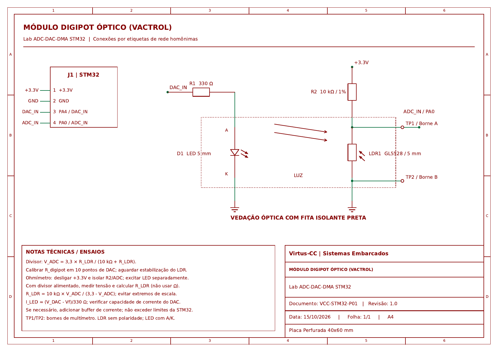

# Lab 4: Potenciômetro Digital Emulado via Acoplamento Óptico (ADC, DAC e DMA)
**Formação em Sistemas Embarcados Virtus-CC — Curso 2: Periféricos**  
**Prof. D.Sc. Rafael Bezerra Correia Lima**

---

> [!NOTE]
> **Estilo de Codificação:** A arquitetura de firmware, nomenclatura de identificadores, encapsulamento via struct de dados locais (Regra 4.8), camada de abstração de hardware (`Bsp`), filtros em média móvel e padronização Doxygen deste repositório foram inspiradas nas diretrizes de boas práticas do **Laboratório ASSERT (IFPB)**.

---

## 1. Descrição da Solução

Este projeto implementa um **Potenciômetro Digital Emulado (Digipot)** baseado em **Vactrol** (acoplamento óptico entre LED e LDR isolado em tubo termo-retrátil opaco).
O firmware utiliza conversão Digital-Analógica (DAC ou PWM filtrado de 12 bits) para controlar a corrente do LED emissor e um conversor Analógico-Digital (ADC de 12 bits com DMA e filtro de média móvel de 16 amostras) para medir a resistência resultante no circuito divisor de tensão.

### Características do Firmware:
- **Resolução da Palavra Digital:** 8 bits ($0$ a $255$).
- **Look-Up Table (LUT):** Vetor de 256 posições em Flash/RAM mapeando `resWord` $\to$ valor de saída do DAC (`0` a `4095`).
- **Atualização Dinâmica de Calibração:** Recepção contínua via **UART com DMA circular**, permitindo reprogramar a curva de calibração em tempo de execução sem travar a CPU.
- **Validação Automatizada:** Sequência de teste em 10 pontos de controle com cálculo do erro quadrático médio (RMSE).

---

## 2. Pinagem de Conexão

| Elemento do Circuito | Pino MCU (Black Pill / F411) | Pino MCU (H723 / F767ZI) | Função |
| :---: | :---: | :---: | :--- |
| **Entrada do LDR (Divisor)** | `PA0` | `PA0` | `ADC1_IN0` (Leitura Analógica) |
| **Controle do LED (Vactrol)** | `PA4` | `PA4` | `TIM2_CH1` (PWM 12-bit) / `DAC1_OUT1` |
| **UART TX** | `PA9` | `PA9` / `PD8` (ST-Link VCP) | Telemetria serial a 115200 bps |
| **UART RX (DMA)** | `PA10` | `PA10` / `PD9` | Carga de nova LUT via DMA |
| **LED Heartbeat** | `PC13` | `PC13` / `PB0` (Green) | Indicador visual de execução |

### Diagrama Esquemático do Circuito

> O arquivo vetorial completo está disponível em: [Esquematico_Placa1_Digipot_Vactrol.pdf](Docs/Esquematico_Placa1_Digipot_Vactrol.pdf)

---

## 3. Circuito Divisor de Tensão e Equações

O circuito é montado como um divisor de tensão com resistor de precisão $R_2 = 10\text{ k}\Omega$:

$$V_{\text{adc}} = V_{\text{ref}} \cdot \left(\frac{R_{\text{LDR}}}{R_2 + R_{\text{LDR}}}\right)$$

Isolando a resistência do fotoresistor $R_{\text{LDR}}$:

$$R_{\text{LDR}} = R_2 \cdot \left(\frac{V_{\text{adc}}}{V_{\text{ref}} - V_{\text{adc}}}\right)$$

Onde:
- $V_{\text{ref}} = 3.3\text{ V}$
- $R_2 = 10.000\,\Omega$

### Cálculo de RMSE (Root Mean Square Error):

$$\text{RMSE} = \sqrt{\frac{1}{N} \sum_{i=1}^{N} \left(R_{\text{medido}}[i] - R_{\text{esperado}}[i]\right)^2}$$

---

## 4. Roteiro de Calibração e Testes

1. Conecte o osciloscópio ou multímetro sobre os terminais do LDR.
2. Abra um terminal serial (PuTTY, minicom, CuteCom ou monitor do CubeIDE) a **115200 bps, 8-N-1**.
3. Ao energizar a placa, o firmware iniciará a sequência automática de 10 passos:
   - Word = 0 (Luz apagada $\to$ alta resistência, ~100 k$\Omega$)
   - Word = 255 (Luz máxima $\to$ baixa resistência, ~500 $\Omega$)
4. O terminal exibe para cada ponto o valor aplicado, o valor medido e o erro individual.
5. Ao final dos 10 passos, o RMSE global da curva é reportado.
